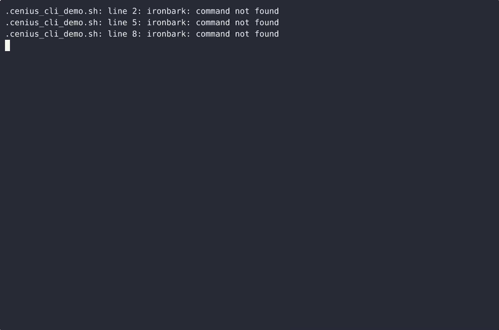
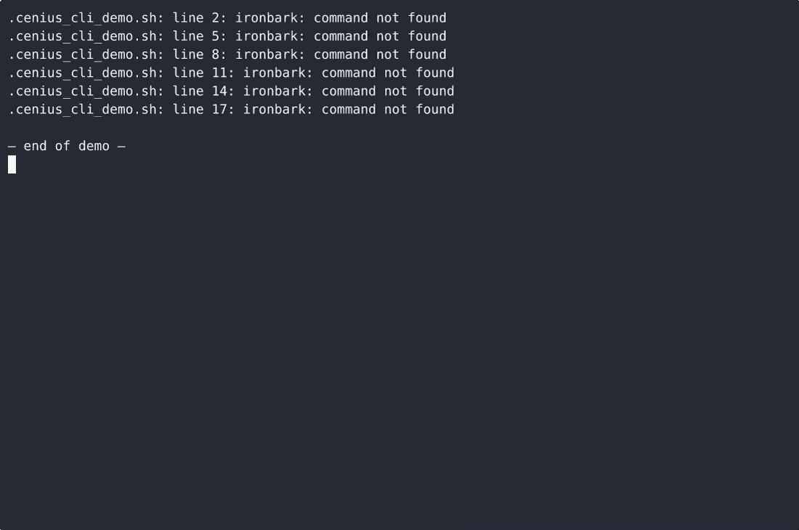

# IronBark — complete Full-stack app command-line tool example app

**IronBark** is a free, open-source command-line tool written in Full-stack app. IronBark is a single-file, standard-library-only Python command-line reference for blacksmiths: it prints the heat colour for a temperature in °C, the recommended quench medium for a named alloy, and the hammer strike…. Every IronBark file — code, design, seeded demo data — ships in this repository under the Apache-2.0 license. Self-host it, or [remix IronBark on cenius.ai](https://cenius.ai/marketplace/p/ironbark?ref=gh&utm_campaign=ironbark-webapp) to get a custom build with full rebrand rights.


[](LICENSE)  [](https://cenius.ai)

[](https://cenius.ai/marketplace/p/ironbark?ref=gh&utm_campaign=ironbark-webapp)

> **▶ [Open & edit in cenius.ai](https://cenius.ai/marketplace/p/ironbark?ref=gh&utm_campaign=ironbark-webapp)** — one click to an editable workspace: describe changes in plain English, get an instant preview, one-click deploy and host. Modifications made on the platform come with full rebrand & relicense rights.

_Local clone? See [Quick start](#quick-start) below. cenius.ai is the zero-setup path._

## Demo


▶ **[Watch the full demo video](https://cenius.ai/marketplace/p/ironbark?ref=gh&utm_campaign=ironbark-webapp)** — the complete walkthrough, playing on the project's cenius.ai page · [MP4 file](.github/media/demo.mp4)

## Screenshots

 

## Architecture

Full-stack app project, delivered as a complete runnable codebase (24 files). Top-level layout: `tests/`. Run `./install.sh` once to install packages and populate demo data — the app is ready to use immediately after. See [`INSTALL.md`](INSTALL.md) for complete setup instructions.

## Features

- Heat colour reference
- Quench medium per alloy
- Hammer strike order per billet

## Quick start

```bash
./install.sh   # installs dependencies + seeds demo data
```

See [`INSTALL.md`](INSTALL.md) for full setup and usage instructions.

## Usage guide

### Overview

Blacksmith shop reference: heat colour by temperature, quench medium per alloy, hammer strike order per billet.

### Quickstart

```bash
ironbark --help
## or, if installed from source without symlink:
python -m ironbark --help
```

### Commands

This CLI exposes **3** subcommands. Each was extracted from the source.

| Command | Source file |
|---------|-------------|
| `ironbark heat` | `ironbark.py` |
| `ironbark quench` | `ironbark.py` |
| `ironbark strike` | `ironbark.py` |

#### Per-command help

```bash
ironbark --help                # top-level help
ironbark heat --help    # help for `heat`
```

### Worked example

1. Verify the CLI is on your PATH: `which ironbark` (or run via `cargo run --`/`python -m`).
2. Show all subcommands: `ironbark --help`.
3. Try the first detected subcommand:

```bash
ironbark heat --help
```

### Reference

#### Entry points

| Kind | Name | Source |
|------|------|--------|
| Console script | `ironbark` | `ironbark:run_cli` (pyproject.toml) |

#### Surface index (auto-extracted)

| Kind | Title | Source file |
|------|-------|-------------|
| command | `heat` | `ironbark.py` |
| command | `quench` | `ironbark.py` |
| command | `strike` | `ironbark.py` |

### Next steps

- Read [INSTALL.md](./INSTALL.md) if anything in the Quickstart didn't work.
- Inspect `.env.example` for the full list of environment variables this project understands.
- See [README.md](./README.md) for the architecture diagram + feature list.

_Full guide: [`USAGE.md`](USAGE.md)_

## FAQ

### What does it take to self-host IronBark?

Pull the repo, run `./install.sh`, and you are up — the script installs packages and pre-seeds the database. [`INSTALL.md`](INSTALL.md) covers any platform-specific tweaks.

### Can I build a business on IronBark?

It is. Apache-2.0 licensing means you can build a product on it, sell it, or use it inside a company with no fees. Details: [LICENSE](LICENSE).

### Is it possible to white-label IronBark for a client?

Yes — and the easiest way is [remixing it on cenius.ai](https://cenius.ai/marketplace/p/ironbark?ref=gh&utm_campaign=ironbark-webapp): modifications made on the platform come with full rebrand and relicense rights over your derivative.

### Is there a no-code way to modify IronBark?

Describe what you want changed on [cenius.ai](https://cenius.ai/marketplace/p/ironbark?ref=gh&utm_campaign=ironbark-webapp) — no code editing needed; the platform produces a fresh build you can download and deploy.

### Which technology stack does IronBark use?

IronBark runs on Full-stack app. This repo holds the full production source: you can inspect every part of it before deploying. Highlights include hammer strike order per billet.

## License & rebranding

Released under the [Apache License 2.0](LICENSE) (© 2026 Cenius AI) — free for personal and commercial use. The Cenius name/logo are trademarks (see NOTICE).

**Need a customized version?** [Remix this app on cenius.ai](https://cenius.ai/marketplace/p/ironbark?ref=gh&utm_campaign=ironbark-webapp) — modifications made on the platform come with **full rebrand & relicense rights** over your derivative.

## Built with cenius.ai

This entire application — code, design, seeded demo data — was generated on **[cenius.ai](https://cenius.ai)** from a plain-English description.

- 🚀 [Build your own app on cenius.ai](https://cenius.ai)
- 🎛️ [Remix IronBark on the marketplace](https://cenius.ai/marketplace/p/ironbark?ref=gh&utm_campaign=ironbark-webapp) — open it in a workspace, prompt for changes, and ship your own version.

More open-source apps: [the Cenius-ai catalog](https://github.com/Cenius-ai) · [showcase index](https://github.com/Cenius-ai/showcase)
